# Hirgal Complete Database Entity Relationship Diagram (ERD) — 27 Tables

This document presents the complete Entity Relationship Diagram covering all **27 domain tables** for the Hirgal platform.

---

```mermaid
erDiagram
    USERS ||--o| USER_PROFILES : "has profile"
    USERS ||--o{ SESSIONS : "establishes"
    USERS ||--o{ USER_ROLES : "assigned"
    ROLES ||--o{ USER_ROLES : "granted to"
    ROLES ||--o{ ROLE_PERMISSIONS : "contains"
    PERMISSIONS ||--o{ ROLE_PERMISSIONS : "attached to"
    ROLES ||--o{ USER_INVITATIONS : "pre-assigned to"
    USERS ||--o{ USER_INVITATIONS : "issued by"

    USERS ||--o{ PROJECTS : "creates / owns"
    PROJECTS ||--o{ PROJECT_MEMBERS : "contains"
    USERS ||--o{ PROJECT_MEMBERS : "joins"
    PROJECTS ||--o{ PROJECT_INVITATIONS : "invites to"
    USERS ||--o{ PROJECT_INVITATIONS : "invited by"

    USERS ||--o{ TEAMS : "leads"
    TEAMS ||--o{ TEAM_MEMBERS : "contains"
    USERS ||--o{ TEAM_MEMBERS : "belongs to"
    PROJECTS ||--o{ PROJECT_TEAMS : "allocated"
    TEAMS ||--o{ PROJECT_TEAMS : "assigned to"

    PROJECTS ||--o{ TASKS : "contains"
    TASKS ||--o{ TASKS : "subtask parent"
    USERS ||--o{ TASKS : "authors"
    TASKS ||--o{ TASK_ASSIGNMENTS : "assigned to"
    USERS ||--o{ TASK_ASSIGNMENTS : "performs"
    USERS ||--o{ TASK_ASSIGNMENTS : "delegated by"
    TASKS ||--o{ TASK_COMMENTS : "has comments"
    USERS ||--o{ TASK_COMMENTS : "writes"
    TASK_COMMENTS ||--o{ TASK_COMMENTS : "nested reply to"
    TASKS ||--o{ TASK_ATTACHMENTS : "stores"
    USERS ||--o{ TASK_ATTACHMENTS : "uploaded by"

    USERS ||--o{ APPOINTMENTS : "hosts"
    APPOINTMENTS ||--o{ APPOINTMENT_PARTICIPANTS : "invites"
    USERS ||--o{ APPOINTMENT_PARTICIPANTS : "attends"

    USERS ||--o{ HABITS : "tracks"
    HABITS ||--o{ HABIT_LOGS : "composite FK (habit_id, user_id)"

    USERS ||--o{ NOTIFICATIONS : "receives"
    USERS ||--o{ USER_MENTIONS : "targeted in"
    USERS ||--o{ USER_MENTIONS : "mentioned by"
    USERS ||--o{ ACTIVITY_LOGS : "performed by"

    USERS {
        bigint_unsigned id PK
        varchar_255 name
        varchar_255 email UK
        timestamp email_verified_at
        varchar_255 password
        varchar_50 account_status
        varchar_1024 avatar_url
        varchar_50 timezone
        timestamp last_login_at
        timestamp created_at
        timestamp updated_at
        timestamp deleted_at
    }

    USER_PROFILES {
        bigint_unsigned id PK
        bigint_unsigned user_id FK,UK
        varchar_30 phone
        varchar_100 job_title
        varchar_100 department
        text bio
        json notification_preferences
        varchar_30 theme_preference
        timestamp created_at
        timestamp updated_at
    }

    SESSIONS {
        varchar_255 id PK
        bigint_unsigned user_id FK
        varchar_45 ip_address
        text user_agent
        longtext payload
        int_unsigned last_activity
    }

    USER_INVITATIONS {
        bigint_unsigned id PK
        varchar_255 email
        bigint_unsigned role_id FK
        char_64 token_hash UK
        varchar_50 status
        bigint_unsigned invited_by FK
        timestamp expires_at
        timestamp accepted_at
        timestamp created_at
        timestamp updated_at
    }

    PASSWORD_RESET_TOKENS {
        varchar_255 email PK
        varchar_255 token
        timestamp created_at
    }

    PERSONAL_ACCESS_TOKENS {
        bigint_unsigned id PK
        varchar_255 tokenable_type
        bigint_unsigned tokenable_id
        varchar_255 name
        char_64 token UK
        text abilities
        timestamp last_used_at
        timestamp expires_at
        timestamp created_at
        timestamp updated_at
    }

    ROLES {
        bigint_unsigned id PK
        varchar_100 name UK
        varchar_100 slug UK
        varchar_255 description
        boolean is_system
        timestamp created_at
        timestamp updated_at
    }

    PERMISSIONS {
        bigint_unsigned id PK
        varchar_100 name UK
        varchar_100 slug UK
        varchar_50 module
        varchar_255 description
        timestamp created_at
        timestamp updated_at
    }

    ROLE_PERMISSIONS {
        bigint_unsigned id PK
        bigint_unsigned role_id FK
        bigint_unsigned permission_id FK
        timestamp created_at
        timestamp updated_at
    }

    USER_ROLES {
        bigint_unsigned id PK
        bigint_unsigned user_id FK
        bigint_unsigned role_id FK
        timestamp created_at
        timestamp updated_at
    }

    PROJECTS {
        bigint_unsigned id PK
        char_36 uuid UK
        varchar_255 name
        varchar_255 slug UK
        text description
        varchar_50 status
        varchar_50 priority
        bigint_unsigned owner_id FK
        date start_date
        date due_date
        timestamp completed_at
        json settings
        timestamp created_at
        timestamp updated_at
        timestamp deleted_at
    }

    PROJECT_MEMBERS {
        bigint_unsigned id PK
        bigint_unsigned project_id FK
        bigint_unsigned user_id FK
        varchar_50 role
        timestamp joined_at
        timestamp created_at
        timestamp updated_at
    }

    PROJECT_INVITATIONS {
        bigint_unsigned id PK
        bigint_unsigned project_id FK
        varchar_255 email
        varchar_50 role
        char_64 token_hash UK
        varchar_50 status
        bigint_unsigned invited_by FK
        timestamp expires_at
        timestamp accepted_at
        timestamp created_at
        timestamp updated_at
    }

    TEAMS {
        bigint_unsigned id PK
        char_36 uuid UK
        varchar_255 name
        varchar_255 slug UK
        text description
        bigint_unsigned leader_id FK
        timestamp created_at
        timestamp updated_at
        timestamp deleted_at
    }

    TEAM_MEMBERS {
        bigint_unsigned id PK
        bigint_unsigned team_id FK
        bigint_unsigned user_id FK
        varchar_50 role
        timestamp joined_at
        timestamp created_at
        timestamp updated_at
    }

    PROJECT_TEAMS {
        bigint_unsigned id PK
        bigint_unsigned project_id FK
        bigint_unsigned team_id FK
        timestamp assigned_at
        timestamp created_at
        timestamp updated_at
    }

    TASKS {
        bigint_unsigned id PK
        char_36 uuid UK
        bigint_unsigned project_id FK
        bigint_unsigned parent_id FK
        varchar_255 title
        longtext description
        varchar_50 status
        varchar_50 priority
        bigint_unsigned creator_id FK
        datetime due_date
        decimal estimated_hours
        decimal actual_hours
        int_unsigned order_column
        timestamp completed_at
        timestamp created_at
        timestamp updated_at
        timestamp deleted_at
    }

    TASK_ASSIGNMENTS {
        bigint_unsigned id PK
        bigint_unsigned task_id FK
        bigint_unsigned user_id FK
        bigint_unsigned assigned_by FK
        timestamp assigned_at
        timestamp created_at
        timestamp updated_at
    }

    TASK_COMMENTS {
        bigint_unsigned id PK
        bigint_unsigned task_id FK
        bigint_unsigned user_id FK
        bigint_unsigned parent_id FK
        text body
        timestamp created_at
        timestamp updated_at
        timestamp deleted_at
    }

    TASK_ATTACHMENTS {
        bigint_unsigned id PK
        bigint_unsigned task_id FK
        bigint_unsigned user_id FK
        varchar_255 file_name
        varchar_1024 file_path
        varchar_100 mime_type
        bigint_unsigned file_size
        timestamp created_at
        timestamp updated_at
    }

    APPOINTMENTS {
        bigint_unsigned id PK
        char_36 uuid UK
        bigint_unsigned organizer_id FK
        varchar_255 title
        text description
        datetime start_time
        datetime end_time
        varchar_50 location_type
        varchar_1024 meeting_link
        varchar_255 location_address
        varchar_50 status
        timestamp created_at
        timestamp updated_at
        timestamp deleted_at
    }

    APPOINTMENT_PARTICIPANTS {
        bigint_unsigned id PK
        bigint_unsigned appointment_id FK
        bigint_unsigned user_id FK
        varchar_50 status
        text response_notes
        timestamp responded_at
        timestamp created_at
        timestamp updated_at
    }

    NOTIFICATIONS {
        char_36 id PK
        varchar_255 type
        varchar_255 notifiable_type
        bigint_unsigned notifiable_id
        json data
        timestamp read_at
        timestamp created_at
        timestamp updated_at
    }

    USER_MENTIONS {
        bigint_unsigned id PK
        varchar_255 mentionable_type
        bigint_unsigned mentionable_id
        bigint_unsigned mentioned_user_id FK
        bigint_unsigned author_id FK
        varchar_500 context_excerpt
        timestamp read_at
        timestamp created_at
        timestamp updated_at
    }

    HABITS {
        bigint_unsigned id PK
        char_36 uuid UK
        bigint_unsigned user_id FK
        varchar_255 title
        text description
        varchar_50 frequency
        json target_days
        varchar_20 color
        boolean is_archived
        timestamp created_at
        timestamp updated_at
        timestamp deleted_at
    }

    HABIT_LOGS {
        bigint_unsigned id PK
        bigint_unsigned habit_id FK
        bigint_unsigned user_id FK
        date logged_date
        varchar_50 status
        text notes
        timestamp created_at
        timestamp updated_at
    }

    ACTIVITY_LOGS {
        bigint_unsigned id PK
        bigint_unsigned user_id FK
        varchar_100 action
        varchar_255 subject_type
        bigint_unsigned subject_id
        varchar_500 description
        json properties
        varchar_45 ip_address
        text user_agent
        timestamp created_at
    }
```

